# Employee Attrition Prediction Using Machine Learning

**A Predictive Analytics Project Report (CA3)**

| | |
|---|---|
| Submitted by | `[STUDENT NAME]` |
| Registration number | `[REGISTRATION NUMBER]` |
| Programme / Section | B.Tech Computer Science Engineering, `[SECTION]` |
| Course | Predictive Analytics (`[COURSE CODE]`) |
| Assessment | CA3 – Individual Project |
| Faculty | `[FACULTY NAME]` |
| Institution | `[UNIVERSITY / COLLEGE NAME]` |
| Date | `[SUBMISSION DATE]` |

> Fields in `[BRACKETS]` are placeholders to be completed by the student. All experimental results in this report were produced by the accompanying notebook `notebooks/Employee_Attrition_Prediction.ipynb`, executed end to end with Python 3.13.9, scikit-learn 1.9.1 and XGBoost 3.4.1.

---

## Abstract

Employee attrition imposes recruitment, training and productivity costs on organisations. This project applies the Knowledge Discovery in Databases (KDD) process to the IBM HR Analytics Employee Attrition & Performance dataset (1,470 fictional employee records, 35 attributes, 16.1% attrition) to build and evaluate a supervised binary classifier that estimates the probability that an employee will leave.

**Data preparation and EDA.**
- No missing values or duplicates were found.
- Three constant columns and one identifier were removed.
- Outliers were examined and retained as plausible values.
- Exploratory analysis with confidence-interval-annotated attrition rates showed that attrition is concentrated among employees who work overtime (30.5% vs 10.4%), employees in their first two years at the company (34.9%), and those in the lowest income quintile (31.3%).

**Modelling.**
- Three models were trained inside leakage-safe scikit-learn pipelines and tuned with stratified 5-fold cross-validation on an 80% training split: Logistic Regression, Random Forest and XGBoost.
- Class imbalance was handled with class weights.
- On the 20% held-out test set the models achieved ROC-AUC values of 0.803, 0.790 and 0.786 respectively. Their 95% bootstrap confidence intervals overlap substantially.

**Final model.**
- Logistic Regression was selected on cross-validated ROC-AUC and simplicity.
- At a recall-oriented threshold of 0.40, chosen on training data, it identified 76.6% of test-set leavers at a precision of 31.3%.
- Permutation importance identified overtime as the dominant predictor in all three models, followed by income, experience, tenure and promotion timing, satisfaction, business travel and marital status.

The report discusses the limitations of the synthetic dataset, the difference between predictive and causal importance, and the ethical constraints on using such models in human-resource decisions.

**Keywords:** employee attrition, predictive analytics, KDD, logistic regression, random forest, XGBoost, class imbalance, permutation importance, HR analytics.

---

## Table of Contents

1. Introduction
2. Literature Review
3. Workflow / Predictive Modelling Process
4. Results and Discussion
5. Conclusion
6. References

---

# Chapter 1: Introduction

## 1.1 Background of Predictive Analytics

Analytics in organisations is usually described at three levels:
- **Descriptive analytics** summarises what has happened, for example last year's turnover rate.
- **Predictive analytics** uses historical data to estimate what is likely to happen for new cases.
- **Prescriptive analytics** recommends actions.

Predictive analytics relies on statistical and machine-learning models that learn a mapping from input variables (features) to an outcome (target) from labelled historical examples. A model is useful only if it generalises, that is, if it performs well on data it has not seen. Methodical data preparation, honest evaluation on held-out data, and careful interpretation are therefore as important as the choice of algorithm.

The Knowledge Discovery in Databases (KDD) process, described by Fayyad, Piatetsky-Shapiro and Smyth [1], frames this as an iterative sequence of selection, preprocessing, transformation, data mining and interpretation/evaluation. This project follows that process.

## 1.2 Employee Attrition

*Employee attrition* (or *turnover*) refers to employees leaving an organisation. It may be voluntary (resignation) or involuntary (dismissal, retirement). Turnover has been studied in organisational psychology for about a century [5]. Costs arise from:
- recruitment and selection;
- onboarding and training of replacements;
- lost productivity while positions are vacant or new staff are learning;
- the loss of tacit knowledge and client relationships.

Not all attrition is harmful, but unexpected departures of capable employees are a recurring management concern.

## 1.3 Problem Statement

Organisations face difficulty in identifying employees who may leave. The objective of this project is to develop a machine-learning classification system that predicts whether an employee is likely to leave, using employee attributes available in the dataset. These include age, job role, monthly income, job satisfaction, overtime, years at the company and work-life balance. The system should also explain its performance, the attributes it relies on, and its limitations.

## 1.4 Motivation

- **Too late to act.** HR departments typically learn of a departure when a resignation is submitted, which leaves little room for action.
- **Patterns in historical data.** If historical records show systematic differences between employees who left and those who stayed, a model can rank current employees by similarity to past leavers. This could help HR prioritise supportive, group-level interventions such as workload reviews, career-development conversations or pay-band reviews.
- **Learning value.** The project is also a vehicle for learning the complete predictive-analytics workflow on a realistic, imbalanced classification problem.

## 1.5 Objectives

1. Understand and analyse employee-related data.
2. Identify patterns and factors associated with employee attrition.
3. Clean and preprocess the dataset.
4. Perform exploratory data analysis using appropriate visualisations.
5. Engineer and select relevant predictive features.
6. Train Logistic Regression, Random Forest and XGBoost classification models.
7. Evaluate and compare the models using appropriate metrics.
8. Interpret model predictions and identify important features.
9. Develop a reusable function for predicting employee attrition.
10. Document the complete KDD process and communicate the findings through a report and an individual presentation.

## 1.6 Scope

**In scope:**
- A single, publicly available dataset.
- Three classification algorithms.
- Offline evaluation on a held-out test set.
- Model interpretation with established feature-importance methods.
- A prediction function and a saved model.

**Out of scope:**
- Deployment as a web service.
- Integration with live HR systems.
- Causal inference about why employees leave.
- Any use of the model to make decisions about real individuals.

## 1.7 Significance

The project demonstrates how an attrition-risk model can be built reproducibly and evaluated honestly:
- appropriate metrics for imbalanced data;
- confidence intervals;
- leakage-safe preprocessing;
- a model-selection rule fixed before looking at the test set.

It also shows how such a model should be interpreted cautiously: predictive importance is not causal importance, and HR use cases raise fairness and accountability concerns [16].

## 1.8 Overview of the Proposed Approach

The data is loaded and profiled, cleaned with every decision logged, and explored with attrition-rate charts that carry 95% Wilson confidence intervals [27]. Five candidate features are engineered and tested by cross-validation.

A stratified 80/20 train-test split is made. Logistic Regression, Random Forest and XGBoost are tuned with 5-fold stratified cross-validation inside scikit-learn pipelines. The tuned models are evaluated once on the test set, with bootstrap confidence intervals [28].

The final model is selected using cross-validated ROC-AUC and simplicity. Its decision threshold is chosen on out-of-fold training predictions to favour recall. The model is then interpreted with coefficients, impurity and gain importance, and permutation importance.

---

# Chapter 2: Literature Review

## 2.1 Employee Turnover and HR Analytics

**Mobley (1977) [3].** *Objective:* explain the psychological process that links job dissatisfaction to quitting. *Method:* Mobley proposed a conceptual model of "intermediate linkages". In this model, dissatisfaction leads to thoughts of quitting, an evaluation of the expected utility of searching and the cost of quitting, an intention to search, the search itself, the evaluation of alternatives, an intention to quit, and finally quitting. *Contribution:* the model shifted attention from satisfaction alone to the decision sequence that precedes leaving. *Relevance:* it explains why satisfaction ratings such as `JobSatisfaction` and `EnvironmentSatisfaction` may be associated with attrition, and also why their effect may be indirect and only moderate.

**Griffeth, Hom and Gaertner (2000) [4].** *Objective:* update earlier quantitative summaries of what predicts turnover. *Method:* a meta-analysis that statistically pooled results from many empirical turnover studies. *Contribution:* it consolidated evidence on the relative strength of different predictors. Attitudinal and withdrawal-process variables, such as job satisfaction, organisational commitment, job search and quit intentions, emerged among the stronger correlates, while demographic characteristics generally showed weaker relationships. *Relevance:* the IBM dataset contains several attitudinal ratings but no measure of commitment or intention to quit. This bounds how well any model trained on it can perform.

**Hom, Lee, Shaw and Hausknecht (2017) [5].** *Objective:* review a century of turnover theory and research published in the *Journal of Applied Psychology*. *Method:* a narrative and historical review. *Contribution:* it traces how the field moved from early process models to approaches such as job embeddedness and collective (unit-level) turnover, and it identifies open research directions. *Relevance:* it positions predictive modelling as one strand of a much broader, theory-driven literature. Attrition is shaped by factors (labour markets, life events, embeddedness) that a cross-sectional HR snapshot cannot capture.

## 2.2 Traditional Statistical Approaches to Turnover

Classical turnover research has relied mainly on correlation, multiple regression, logistic regression and survival-type analyses, applied to survey and personnel data and interpreted through theory [4], [5]. These methods emphasise *explanation*: estimating and testing the association between a specific variable and turnover while controlling for others. The machine-learning approach in this project emphasises *prediction*: maximising out-of-sample accuracy for new cases. The two goals overlap but are not the same. A model can predict well without isolating causes, and this distinction is maintained throughout the report.

## 2.3 Logistic Regression for Classification

**Cox (1958) [6]** developed regression methods for binary outcomes in which the log-odds of the outcome is modelled as a linear function of explanatory variables. This is the foundation of logistic regression. **Hosmer, Lemeshow and Sturdivant [7]** provide the standard treatment of fitting, interpreting (through odds ratios) and assessing logistic-regression models.

*Relevance:* logistic regression is the natural baseline for a binary target such as attrition. It is fast, has well-understood statistical properties, outputs probabilities, and its coefficients can be explained to non-specialists. Its main limitation is that it assumes a linear relationship on the log-odds scale unless interactions or transformations are added.

## 2.4 Decision Trees and Random Forest

**Breiman (2001) [8]** introduced Random Forests. *Method:* an ensemble of decision trees, each grown on a bootstrap sample of the data and restricted to a random subset of features at each split, with predictions made by majority vote or averaging. *Contribution:* he showed that injecting randomness decorrelates the trees, so averaging them reduces variance substantially compared with a single tree. He also introduced out-of-bag error estimates and variable-importance measures. *Relevance:* Random Forest is a strong, widely used non-linear benchmark that can capture interactions (for example between overtime and job level) without manual feature construction.

**Strobl, Boulesteix, Zeileis and Hothorn (2007) [14]** showed that the impurity-based (Gini) variable importance of random forests is biased in favour of continuous variables and variables with many categories, and proposed alternatives. *Relevance:* this project therefore does not rely on impurity importance alone and adds permutation importance.

## 2.5 Gradient Boosting and XGBoost

**Friedman (2001) [9]** formulated gradient boosting as gradient descent in function space. Weak learners, typically shallow regression trees, are added sequentially, each fitted to the negative gradient of the loss of the current ensemble, and each is scaled by a shrinkage (learning-rate) factor.

**Chen and Guestrin (2016) [10]** presented XGBoost, a scalable implementation of tree boosting. Its contributions include:
- a regularised learning objective that penalises tree complexity;
- a sparsity-aware split-finding algorithm and a weighted quantile sketch;
- system-level optimisations for cache access and out-of-core computation.

*Relevance:* XGBoost is frequently among the strongest methods on tabular data, which makes it an appropriate candidate here. Its many hyperparameters, however, make it prone to overfitting on small datasets unless it is regularised.

## 2.6 Machine Learning for Employee-Turnover Prediction

**Punnoose and Ajit (2016) [11].** *Objective:* predict employee turnover using HR information-system (HRIS) data, which is often noisy. *Method:* XGBoost was compared with six supervised classifiers historically used for this task, on records from a global retailer. *Finding:* the authors report that XGBoost, which they attribute to its regularised formulation, achieved significantly higher accuracy than the other classifiers on their data. *Relevance:* this supports including XGBoost. Their data, however, is a real and much larger HRIS dataset, so the result need not transfer to the small synthetic IBM dataset.

**Zhao, Hryniewicki, Cheng, Fu and Zhu (2018) [12].** *Objective:* assess how reliably supervised learning predicts turnover across HR datasets of different sizes. *Method:* ten classifiers (decision tree, random forest, gradient boosting, XGBoost, logistic regression, support vector machines, neural networks, linear discriminant analysis, naïve Bayes and k-nearest neighbours) were compared on real and simulated datasets representing small, medium and large organisations, using a statistically analysed evaluation procedure. *Contribution:* practical guidance on selecting and interpreting methods according to dataset size and complexity. *Relevance:* it motivates comparing a linear model with tree ensembles rather than assuming one family is always best.

**Fallucchi, Coladangelo, Giuliano and De Luca (2020) [13].** *Objective:* analyse how objective factors influence attrition and predict whether an employee will leave. *Method:* several machine-learning classifiers were trained and tested on the IBM HR Analytics dataset (35 features, about 1,500 samples), the same dataset used in this project. *Finding:* the Gaussian Naïve Bayes classifier gave the best results on their evaluation, with a recall of 0.54. *Relevance:* it is a directly comparable prior study on the same data. It shows that recall for the minority class is the critical and difficult metric. (The authors describe the dataset as real; its Kaggle source describes it as fictional [2]. This report follows the source description.)

## 2.7 Evaluation, Leakage and Explainability

**Imbalanced evaluation.**
- **Fawcett (2006) [19]** provides the standard introduction to ROC analysis and the area under the ROC curve (AUC).
- **Saito and Rehmsmeier (2015) [18]** show that, on imbalanced data, precision-recall plots are more informative than ROC plots, because ROC curves can look optimistic when negatives dominate.

*Relevance:* this project reports both ROC-AUC and PR-AUC.

**Leakage. Kaufman, Rosset, Perlich and Stitelman (2012) [17]** formalise *leakage*: the use of information during model building that would not legitimately be available at prediction time. They discuss how to detect and avoid it. *Relevance:* this motivates the pipeline design (no preprocessing fitted on test data) and the discussion of snapshot-timing risk in tenure variables.

**Feature importance. Altmann, Toloşi, Sander and Lengauer (2010) [15]** propose a permutation-based correction of feature importance (PIMP) to address the bias of impurity importance. *Relevance:* it supports the use of permutation importance, which this project computes on the held-out test set.

**Responsible use. Tambe, Cappelli and Yakubovich (2019) [16]** identify four challenges for artificial intelligence in HR management:
- the complexity of HR outcomes;
- the small size of HR datasets;
- accountability, fairness, ethical and legal constraints;
- possible adverse reactions from employees to algorithmic decisions.

They propose responses based on causal reasoning, randomised experiments and employee involvement. *Relevance:* these challenges shape the limitations and the responsible-use statements of this project. In particular, predictions must not drive decisions about individuals.

## 2.8 Summary of Reviewed Work

| Ref. | Study | Focus | Method | Use in this project |
|---|---|---|---|---|
| [3] | Mobley (1977) | Turnover process theory | Conceptual model | Interpreting satisfaction variables |
| [4] | Griffeth et al. (2000) | Predictors of turnover | Meta-analysis | Expected strength of predictors; missing variables |
| [5] | Hom et al. (2017) | Turnover research history | Review | Context and limitations |
| [6], [7] | Cox (1958); Hosmer et al. (2013) | Binary regression | Logistic model | Model 1 |
| [8] | Breiman (2001) | Ensemble learning | Random Forest | Model 2 |
| [9], [10] | Friedman (2001); Chen & Guestrin (2016) | Boosting | Gradient boosting / XGBoost | Model 3 |
| [11] | Punnoose & Ajit (2016) | Turnover prediction | XGBoost vs 6 classifiers | Motivation for XGBoost |
| [12] | Zhao et al. (2018) | Turnover prediction | 10 classifiers, 3 data sizes | Motivation for model comparison |
| [13] | Fallucchi et al. (2020) | Attrition, IBM dataset | Several classifiers | Comparable prior work |
| [14], [15] | Strobl et al. (2007); Altmann et al. (2010) | Feature importance | Bias analysis; permutation | Interpretation methods |
| [16] | Tambe et al. (2019) | AI in HR | Conceptual analysis | Responsible use |
| [17] | Kaufman et al. (2012) | Leakage | Formal framework | Pipeline design |
| [18], [19] | Saito & Rehmsmeier (2015); Fawcett (2006) | Evaluation | PR and ROC analysis | Metric choice |

## 2.9 Research Gap and Motivation

Prior studies show that machine-learning classifiers can predict turnover above chance, but they report differing "best" algorithms depending on the dataset, the metric and the evaluation protocol [11]–[13]. Studies on the IBM dataset often report accuracy, which is misleading at 16% prevalence, and rarely quantify the uncertainty that comes from its small test sets.

This project does not claim methodological novelty. Its contribution is a carefully controlled, fully reproducible comparison on this dataset that:
1. fixes model-selection and threshold rules before the test set is used;
2. reports threshold-independent metrics (ROC-AUC, PR-AUC) together with bootstrap confidence intervals;
3. measures, rather than assumes, the effect of feature engineering;
4. interprets the models with several importance methods while explicitly separating prediction from causation.

---

# Chapter 3: Workflow / Predictive Modelling Process

## 3.1 Workflow

```
 ┌────────────────────┐   ┌────────────────────┐   ┌────────────────────┐   ┌────────────────────┐
 │ 1 Problem          │──▶│ 2 Data collection  │──▶│ 3 Data             │──▶│ 4 Data cleaning    │
 │   definition       │   │   (load, verify)   │   │   understanding    │   │   (log every step) │
 └────────────────────┘   └────────────────────┘   └────────────────────┘   └─────────┬──────────┘
                                                                                      ▼
 ┌────────────────────┐   ┌────────────────────┐   ┌────────────────────┐   ┌────────────────────┐
 │ 8 Train-test split │◀──│ 7 Encoding &       │◀──│ 6 Feature          │◀──│ 5 Exploratory data │
 │   (80/20, strat.)  │   │   scaling (pipes)  │   │   engineering      │   │   analysis         │
 └─────────┬──────────┘   └────────────────────┘   └────────────────────┘   └────────────────────┘
           ▼
 ┌────────────────────┐   ┌────────────────────┐   ┌────────────────────┐   ┌────────────────────┐
 │ 9 Model development│──▶│ 10 Evaluation on   │──▶│ 11 Feature         │──▶│ 12 Final prediction│
 │   (5-fold CV tune) │   │    held-out test   │   │    importance      │   │    function + save │
 └────────────────────┘   └────────────────────┘   └────────────────────┘   └────────────────────┘
```

*Figure 3.1 – KDD / predictive-modelling workflow implemented in the notebook (one notebook section per box).*

## 3.2 Problem Definition

The task is supervised binary classification. The target `Attrition` was verified to exist and to contain exactly two values ("Yes", "No"). It is encoded as 1 = Left and 0 = Stayed. The model outputs an estimated probability of leaving, which is converted to a class with a decision threshold.

## 3.3 Data Collection and Dataset Description

| Property | Value |
|---|---|
| Name | IBM HR Analytics Employee Attrition & Performance [2] |
| Publisher | Kaggle user `pavansubhasht`; described as "a fictional data set created by IBM data scientists" |
| Version / date | Version 1, last updated 2017-03-31 |
| Licence | ODbL v1.0 (database) / DbCL v1.0 (contents) – redistribution permitted with attribution |
| File used | `IBM_HR_Analytics_Employee_Attrition.csv`, 227,974 bytes, **tab-delimited** (the original Kaggle file is comma-delimited) |
| Shape | 1,470 rows × 35 columns (26 integer, 9 text) |

The loader uses `csv.Sniffer` to detect the delimiter, so either version of the file can be used without code changes.

## 3.4 Data Dictionary

Codes marked "documented" come from the dataset's Kaggle page. Other meanings are inferred from the column name only.

*Table 3.1 – Data dictionary*

| # | Column | Type | Unique | Meaning | Role |
|---|---|---|---|---|---|
| 1 | Age | int | 43 | Age in years (18–60) | Numeric feature |
| 2 | Attrition | text | 2 | Employee left (Yes/No) | **Target** |
| 3 | BusinessTravel | text | 3 | Non-Travel / Travel_Rarely / Travel_Frequently | Categorical feature |
| 4 | DailyRate | int | 886 | Pay-rate field; definition not documented | Numeric feature |
| 5 | Department | text | 3 | Sales / R&D / Human Resources | Categorical feature |
| 6 | DistanceFromHome | int | 29 | Distance to work; units not documented | Numeric feature |
| 7 | Education | int | 5 | Documented: 1 Below College … 5 Doctor | Ordinal feature |
| 8 | EducationField | text | 6 | Field of education | Categorical feature |
| 9 | EmployeeCount | int | 1 | Always 1 | Constant – dropped |
| 10 | EmployeeNumber | int | 1,470 | Unique employee ID | Identifier – dropped |
| 11 | EnvironmentSatisfaction | int | 4 | Documented: 1 Low … 4 Very High | Ordinal feature |
| 12 | Gender | text | 2 | Female / Male | Categorical feature |
| 13 | HourlyRate | int | 71 | Pay-rate field; definition not documented | Numeric feature |
| 14 | JobInvolvement | int | 4 | Documented: 1 Low … 4 Very High | Ordinal feature |
| 15 | JobLevel | int | 5 | Job level 1–5; scale not documented | Ordinal feature |
| 16 | JobRole | text | 9 | Job role | Categorical feature |
| 17 | JobSatisfaction | int | 4 | Documented: 1 Low … 4 Very High | Ordinal feature |
| 18 | MaritalStatus | text | 3 | Single / Married / Divorced | Categorical feature |
| 19 | MonthlyIncome | int | 1,349 | Monthly income; currency not documented | Numeric feature |
| 20 | MonthlyRate | int | 1,427 | Pay-rate field; definition not documented | Numeric feature |
| 21 | NumCompaniesWorked | int | 10 | Companies worked at; inclusion of current employer not documented | Numeric feature |
| 22 | Over18 | text | 1 | Always "Y" | Constant – dropped |
| 23 | OverTime | text | 2 | Works overtime (Yes/No) | Categorical feature |
| 24 | PercentSalaryHike | int | 15 | Latest salary increase (%) | Numeric feature |
| 25 | PerformanceRating | int | 2 | Documented: 1 Low … 4 Outstanding (only 3 and 4 occur) | Ordinal feature |
| 26 | RelationshipSatisfaction | int | 4 | Documented: 1 Low … 4 Very High | Ordinal feature |
| 27 | StandardHours | int | 1 | Always 80 | Constant – dropped |
| 28 | StockOptionLevel | int | 4 | Stock-option level 0–3; meaning not documented | Ordinal feature |
| 29 | TotalWorkingYears | int | 40 | Total years of work experience | Numeric feature |
| 30 | TrainingTimesLastYear | int | 7 | Training sessions last year | Numeric feature |
| 31 | WorkLifeBalance | int | 4 | Documented: 1 Bad … 4 Best | Ordinal feature |
| 32 | YearsAtCompany | int | 37 | Years at current company | Numeric feature |
| 33 | YearsInCurrentRole | int | 19 | Years in current role | Numeric feature |
| 34 | YearsSinceLastPromotion | int | 16 | Years since last promotion | Numeric feature |
| 35 | YearsWithCurrManager | int | 18 | Years with current manager | Numeric feature |

## 3.5 Data Understanding

The following checks were made before any change:
- **Missing values:** 0 cells.
- **Duplicates:** 0 duplicate rows, including when the ID is ignored.
- **Identifier:** `EmployeeNumber` is unique for every row.
- **Constant columns:** three.
- **Target:** 1,233 No (83.9%) and 237 Yes (16.1%), an imbalance ratio of 5.2 : 1. A majority-class predictor would therefore be 83.9% accurate while identifying no leavers.

## 3.6 Data Cleaning

*Table 3.2 – Cleaning log*

| Check | Finding | Action |
|---|---|---|
| Missing values | 0 missing cells | None; imputers kept in pipeline for future inputs |
| Duplicates | 0 exact; 0 ignoring the ID | None |
| Category labels | No whitespace or case inconsistencies | None |
| Invalid values | All coded scales within documented ranges; no negatives; age 18–60 | None |
| Consistency (5 rules, e.g. YearsAtCompany ≤ TotalWorkingYears) | 0 violations | None |
| NumCompaniesWorked = 0 | 197 rows, all with TotalWorkingYears = YearsAtCompany + 1 | Kept; recorded as an undocumented coding convention |
| Outliers (1.5 × IQR) | 713 flagged values in 8 columns | Kept: plausible values (e.g. all 114 income outliers are at job levels 4–5) |
| Constant columns | EmployeeCount, Over18, StandardHours | Dropped |
| Identifier | EmployeeNumber | Dropped |
| Target | Yes/No validated | Encoded 1/0 |

The shape changed from 1,470 × 35 to **1,470 × 31**. No rows were removed.

## 3.7 Exploratory Data Analysis

**Rate definition.** Attrition rates are computed *within* each group: leavers in the group ÷ employees in the group.

**Uncertainty.** Each rate is shown with a 95% Wilson score interval [27], which is reliable for small groups:

$$\tilde p \pm \frac{z}{1+z^2/n}\sqrt{\frac{\hat p(1-\hat p)}{n}+\frac{z^2}{4n^2}}, \qquad \tilde p=\frac{\hat p + z^2/(2n)}{1+z^2/n},\ z=1.96$$

**Visualisations.** The figures cover the class distribution, age, department, job role, income, overtime, job satisfaction, work-life balance, tenure, years since promotion, a correlation heatmap, and further attributes.

## 3.8 Feature Engineering and Selection

**Selection.** Only target-independent removals were made (constants and the identifier). No feature was dropped for having a weak relationship with the target, because doing so on the full dataset would leak test-set information into model design.

**Engineered features.** Five stateless features were derived from existing columns:

| Feature | Definition |
|---|---|
| TenureRatio | YearsAtCompany ÷ TotalWorkingYears (0 if TotalWorkingYears = 0) |
| AvgYearsPerCompany | TotalWorkingYears ÷ (NumCompaniesWorked + 1) |
| PromotionGapRatio | YearsSinceLastPromotion ÷ (YearsAtCompany + 1) |
| MeanSatisfaction | Mean of Environment, Job and Relationship satisfaction and WorkLifeBalance |
| IncomePerJobLevel | MonthlyIncome ÷ JobLevel |

They were adopted only after cross-validation on the training set showed an improvement (Section 4.4).

## 3.9 Encoding and Scaling

A `ColumnTransformer` applies two branches:
- **Numeric columns:** median imputation, followed by standardisation $z = (x-\mu)/\sigma$ for Logistic Regression only.
- **Categorical columns (7):** most-frequent imputation, followed by one-hot encoding with `handle_unknown="ignore"`, which yields 56 model inputs in total.

**Ordinal survey scales** are kept as integers because their order is meaningful.

**Tree models** are not scaled, because their threshold splits are invariant to monotonic transformations of a feature.

**Leakage prevention.** All learned steps live inside a `Pipeline`, so their statistics come only from the data passed to `fit`.

## 3.10 Train-Test Split

The data is split with `train_test_split(test_size=0.2, stratify=y, random_state=42)`:

| Set | Rows | Leavers | Attrition rate |
|---|---|---|---|
| Training | 1,176 | 190 | 16.2% |
| Test | 294 | 47 | 16.0% |

All tuning uses `StratifiedKFold(n_splits=5, shuffle=True, random_state=42)` on the training set. The test set is used once.

## 3.11 Classification Algorithms

**Logistic Regression.** The model estimates

$$P(y=1\mid \mathbf x)=\sigma(\beta_0+\boldsymbol\beta^\top\mathbf x)=\frac{1}{1+e^{-(\beta_0+\boldsymbol\beta^\top\mathbf x)}}$$

by minimising the weighted log-loss plus an L2 penalty $\tfrac{1}{2C}\lVert\boldsymbol\beta\rVert^2$. The coefficient $\beta_j$ is the change in log-odds for a one-unit (here, one standard deviation) increase in $x_j$, and $e^{\beta_j}$ is the odds ratio. Settings: `class_weight="balanced"`, `max_iter=5000`, and C tuned over {0.001, …, 10}.

**Random Forest.** Each of $B=300$ trees is grown on a bootstrap sample. At every split it chooses the best of a random subset of features by Gini impurity $G = 1-\sum_k p_k^2$. The forest probability is the average of the tree probabilities. Settings: `class_weight="balanced_subsample"`; `max_depth`, `min_samples_leaf` and `max_features` tuned over a 32-point grid.

**XGBoost.** The model builds an additive ensemble $\hat y_i^{(t)} = \hat y_i^{(t-1)} + \eta f_t(\mathbf x_i)$. Each new tree $f_t$ minimises a second-order approximation of the loss plus the complexity penalty $\Omega(f)=\gamma T + \tfrac{1}{2}\lambda\lVert w\rVert^2$, where $T$ is the number of leaves and $w$ the leaf weights [10]. Settings: `scale_pos_weight` = 986/190 ≈ 5.19. A randomised search over 40 combinations covered the number of trees, learning rate, depth, `min_child_weight`, subsampling, column sampling, λ and γ.

**Class weights.** Class weights scale each example's contribution to the loss, so that the two classes contribute equally in total. This counteracts the 5 : 1 imbalance without duplicating or synthesising data.

## 3.12 Evaluation Metrics

With TP, TN, FP and FN denoting true/false positives and negatives (positive = Left):

| Metric | Formula |
|---|---|
| Accuracy | $\dfrac{TP+TN}{TP+TN+FP+FN}$ |
| Precision | $\dfrac{TP}{TP+FP}$ |
| Recall | $\dfrac{TP}{TP+FN}$ |
| F1-score | $2\cdot\dfrac{\text{Precision}\cdot\text{Recall}}{\text{Precision}+\text{Recall}}$ |
| $F_\beta$ (β = 2) | $(1+\beta^2)\dfrac{\text{Precision}\cdot\text{Recall}}{\beta^2\,\text{Precision}+\text{Recall}}$ |
| ROC-AUC | Area under the curve of TPR = Recall against FPR = FP/(FP+TN); equals P(score of a random leaver > score of a random stayer) |
| PR-AUC | Average precision: $\sum_n (R_n-R_{n-1})P_n$ |

**Uncertainty.** Test-set uncertainty is estimated with 1,000 bootstrap resamples of the test set, reporting the 2.5th and 97.5th percentiles [28].

**Model-selection rule.** This rule was fixed in advance: choose the highest cross-validated ROC-AUC, preferring the simpler model when alternatives are within one standard deviation.

**Threshold rule.** Maximise F2 on out-of-fold training predictions, reflecting the stated priority on recall.

## 3.13 Feature Importance and Interpretation Methods

1. **Logistic Regression coefficients and odds ratios** on standardised features.
2. **Random Forest impurity importance:** the mean decrease in Gini impurity [8]. It is known to be biased [14].
3. **XGBoost gain importance:** the mean loss reduction from splits on a feature.
4. **Permutation importance [15]:** the mean decrease in test ROC-AUC over 30 random shuffles of each *original* column. All one-hot dummies of a categorical column are shuffled together.

## 3.14 Final Prediction

`predict_attrition(employee)`:
- checks that all 30 required fields are present;
- type-checks every value;
- warns about unseen categories and out-of-range numbers;
- applies the fitted pipeline;
- returns the class, the probability and a plain-language message that states its limits.

The fitted pipeline, threshold and input schema are saved to `models/final_model.joblib`. The feature-engineering function lives in `src/attrition_features.py` so that the model loads outside the notebook.

## 3.15 Tools and Libraries

Python 3.13.9; pandas 3.0.6 [23]; NumPy 2.5.4 [26]; Matplotlib 3.11.2 [24]; Seaborn 0.13.2 [25]; scikit-learn 1.9.1 [20], [21]; XGBoost 3.4.1 [10], [22]; joblib 1.6.0; Jupyter Notebook.

---

# Chapter 4: Results and Discussion

## 4.1 Dataset Inspection Findings

The data was complete and internally consistent. The only irregularity was the `NumCompaniesWorked = 0` pattern: all 197 such rows have TotalWorkingYears exactly one year more than YearsAtCompany. This looks like a convention of the synthetic data generator, so it was documented rather than changed.

Comparing group means, leavers differ most from stayers in:
- stock-option level (−38%);
- tenure and experience variables (−30% to −35%);
- monthly income (4,787 vs 6,833, −30%);
- job level (−24%).

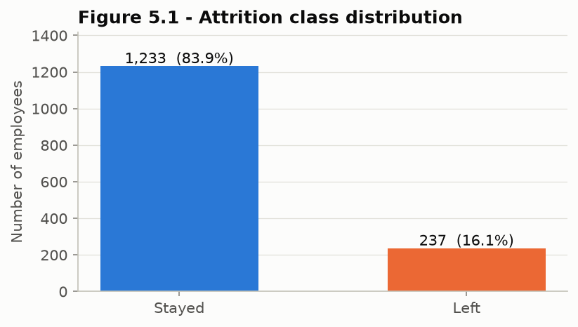

*Figure 4.1 – Attrition class distribution: 1,233 stayed (83.9%) and 237 left (16.1%).*

## 4.2 Exploratory Data Analysis Observations

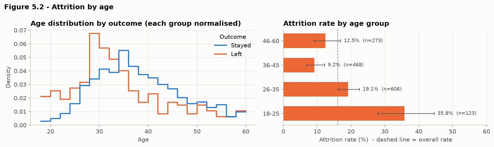

*Figure 4.2 – Attrition by age. Rates: 18–25 years 35.8% (n = 123); 26–35 years 19.1%; 36–45 years 9.2%; 46–60 years 12.5%.*

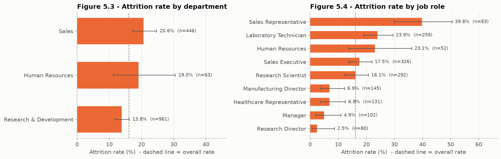

*Figure 4.3 – Attrition by department and by job role. Sales Representatives have the highest rate (39.8%, n = 83) and Research Directors the lowest (2.5%, n = 80).*

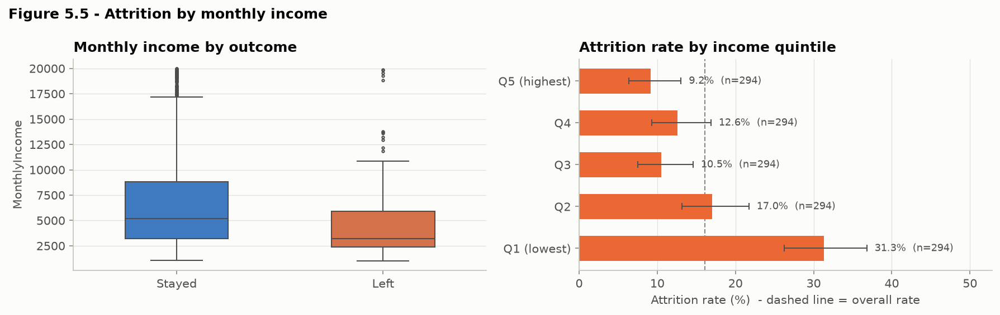

*Figure 4.4 – Attrition by monthly income. Median income is 3,202 for leavers and 5,204 for stayers. Attrition is 31.3% in the lowest income quintile and 9–13% in the top three.*

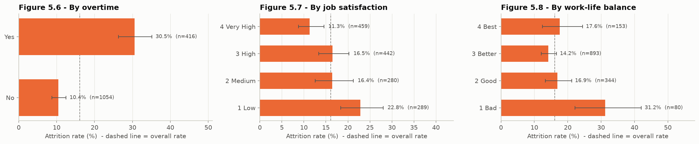

*Figure 4.5 – Attrition by overtime (30.5% vs 10.4%), job satisfaction (22.8% at "Low" vs 11.3% at "Very High") and work-life balance (31.2% at "Bad", n = 80; 14–18% otherwise).*

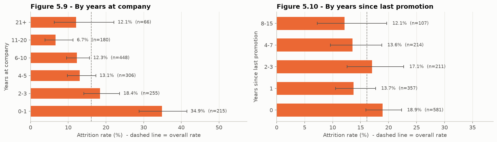

*Figure 4.6 – Attrition by years at the company (34.9% in years 0–1, 6.7% at 11–20 years) and by years since last promotion (no clear one-variable pattern, 12–19% in every band).*

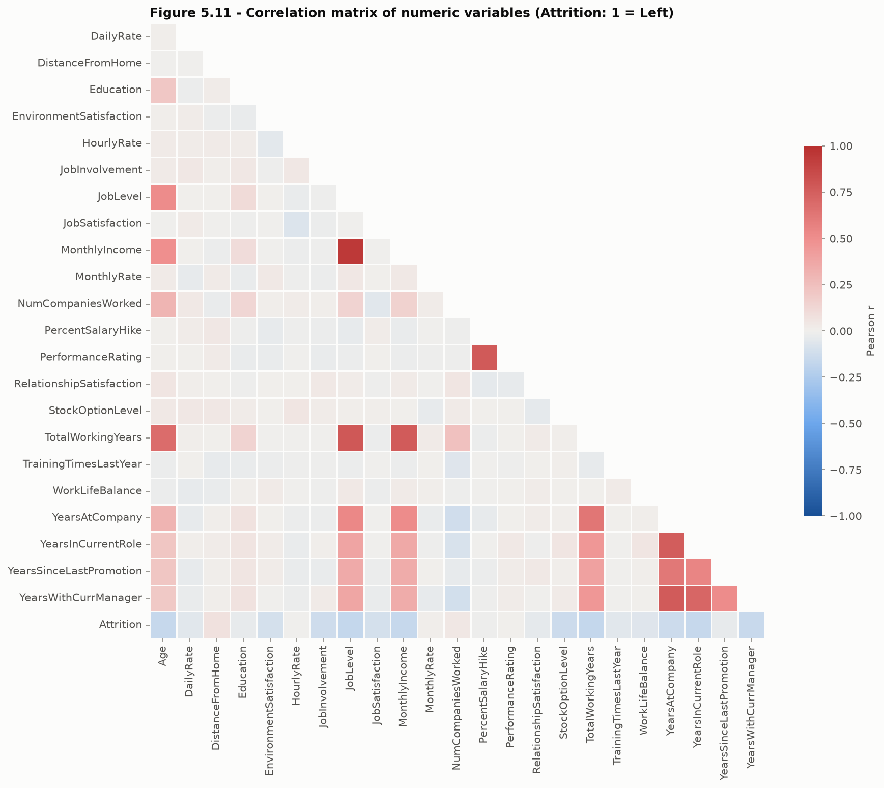

*Figure 4.7 – Pearson correlation matrix of the numeric variables.*

Key points from the correlation matrix:
- **Strongly correlated features:** JobLevel–MonthlyIncome (r = 0.95), JobLevel–TotalWorkingYears (0.78), PercentSalaryHike–PerformanceRating (0.77), MonthlyIncome–TotalWorkingYears (0.77), and the three tenure variables (0.71–0.77).
- **Weak correlations with Attrition:** every one is weak (|r| ≤ 0.17).

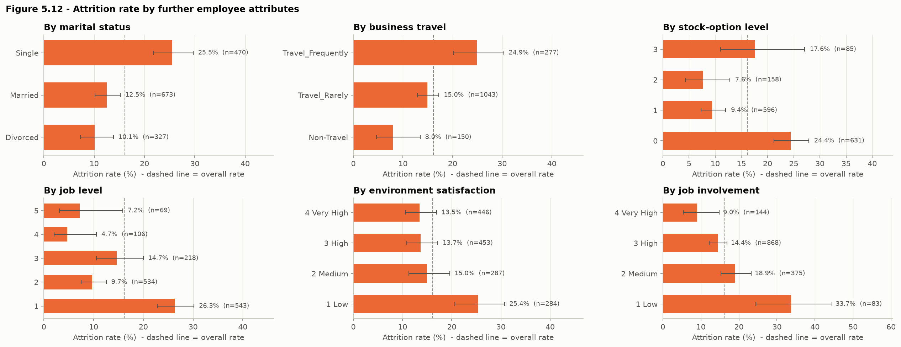

*Figure 4.8 – Attrition by marital status, business travel, stock-option level, job level, environment satisfaction and job involvement.*

**Summary of EDA.** Ranked by the gap between their highest- and lowest-rate groups, the attributes with the largest spread are:

| Attribute | Spread (percentage points) |
|---|---|
| Job role | 37 |
| Tenure band | 28 |
| Age group | 27 |
| Job involvement | 25 |
| Income quintile | 22 |
| Job level | 22 |
| Overtime | 20 |

These attributes overlap strongly with one another; younger employees, for example, also tend to have lower job levels and incomes. All of them are associations, not causes.

## 4.3 Outlier Analysis

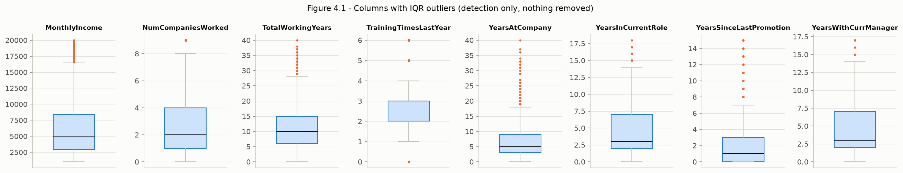

*Figure 4.9 – Columns with IQR outliers. Nothing was removed.*

The 238 flagged values of `TrainingTimesLastYear` arise only because its IQR is 1. All 114 income outliers belong to job levels 4–5, whose median incomes are 16,154 and 19,232. Removing them would delete genuine senior employees and bias the model towards junior staff.

## 4.4 Preprocessing Outcomes and Feature Engineering

After cleaning, 30 input features remained: 23 numeric, of which 9 are ordinal codes, and 7 categorical. One-hot encoding expanded these to 51 columns, or 56 with the engineered features.

*Table 4.1 – Effect of engineered features on mean 5-fold CV ROC-AUC (training data)*

| Model | Original features | + Engineered | Change |
|---|---|---|---|
| Logistic Regression | 0.8273 | 0.8304 | +0.0031 |
| Random Forest | 0.8076 | 0.8184 | +0.0108 |
| XGBoost | 0.7977 | 0.8004 | +0.0027 |

The engineered features improved all three models and were adopted under the pre-stated rule. The average gain (+0.0056), however, is much smaller than the fold-to-fold standard deviation (about 0.02–0.035), so the evidence of a real improvement is weak.

## 4.5 Model Training Details

*Table 4.2 – Tuned hyperparameters and cross-validated performance (training set, mean ± std, threshold 0.5)*

| Model | Selected hyperparameters | CV ROC-AUC | CV PR-AUC | CV Recall | CV Precision | CV F1 | Train-fold ROC-AUC |
|---|---|---|---|---|---|---|---|
| Majority baseline | – | 0.500 | 0.162 | 0.000 | 0.000 | 0.000 | – |
| Logistic Regression | C = 0.1 | **0.833 ± 0.028** | **0.625 ± 0.071** | **0.737 ± 0.055** | 0.383 ± 0.049 | 0.501 ± 0.040 | 0.882 |
| Random Forest | 300 trees, max_depth = None, max_features = sqrt, min_samples_leaf = 1 | 0.818 ± 0.035 | 0.576 ± 0.058 | 0.168 ± 0.068 | **0.861 ± 0.134** | 0.272 ± 0.090 | 1.000 |
| XGBoost | 200 trees, learning_rate = 0.1, max_depth = 2, min_child_weight = 10, subsample = 0.6, colsample_bytree = 0.4, λ = 1, γ = 1 | 0.829 ± 0.020 | 0.618 ± 0.051 | 0.679 ± 0.051 | 0.492 ± 0.029 | **0.568 ± 0.014** | 0.974 |

**Overfitting.** Random Forest fits its training folds perfectly (ROC-AUC 1.000), which shows strong overfitting by the individual trees. XGBoost's search favoured a heavily regularised configuration with shallow trees and strong subsampling.

**Random Forest at the 0.5 threshold.** RF rarely predicts the positive class at 0.5, even with class weights. Fully grown trees have pure leaves, so weighting barely shifts the averaged votes above 0.5. RF ranks employees reasonably well, but 0.5 is not a suitable threshold for it.

## 4.6 Model Comparison on the Test Set

*Table 4.3 – Held-out test-set performance (294 employees, 47 leavers, threshold 0.5)*

| Model | Accuracy | Precision | Recall | F1 | ROC-AUC [95% CI] | PR-AUC |
|---|---|---|---|---|---|---|
| Majority baseline | 0.840 | 0.000 | 0.000 | 0.000 | 0.500 | 0.160 |
| Logistic Regression | 0.762 | 0.361 | **0.638** | 0.462 | **0.803** [0.724, 0.880] | **0.582** |
| Random Forest | **0.850** | **0.714** | 0.106 | 0.185 | 0.790 [0.709, 0.859] | 0.455 |
| XGBoost | 0.786 | 0.389 | 0.596 | **0.471** | 0.786 [0.702, 0.865] | 0.524 |

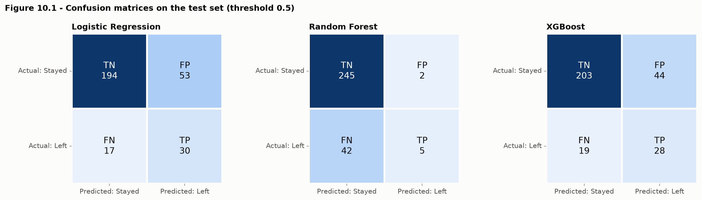

*Figure 4.10 – Confusion matrices at threshold 0.5 (TN / FP / FN / TP): Logistic Regression 194 / 53 / 17 / 30, Random Forest 245 / 2 / 42 / 5, XGBoost 203 / 44 / 19 / 28.*

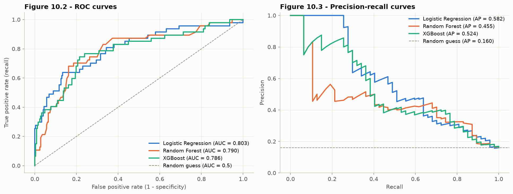

*Figure 4.11 – ROC curves (left) and precision-recall curves (right) on the test set.*

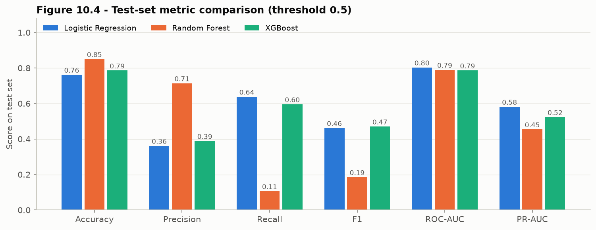

*Figure 4.12 – Test-set metric comparison at threshold 0.5.*

**Discussion.**
- **The accuracy trap.** Random Forest has the highest accuracy (85.0%) yet identifies only 5 of 47 leavers. Its accuracy is barely above the 84.0% of a model that always predicts "Stayed".
- **Ranking quality.** Logistic Regression has the best ROC-AUC and PR-AUC. Its precision-recall curve stays at 1.0 for the employees it scores highest, which means its top-ranked employees are mostly true leavers.
- **Uncertainty.** The bootstrap intervals of the three ROC-AUCs overlap almost completely, and recall intervals are about ±0.14 wide. The test set therefore cannot establish that any one model ranks employees better than the others.
- **CV versus test.** Test ROC-AUCs (0.79–0.80) are slightly below the cross-validated estimates (0.82–0.83) but lie within the cross-validation spread.

## 4.7 Final Model Selection and Operating Threshold

**Choice of model.**
- Logistic Regression had the highest CV ROC-AUC (0.833 ± 0.028).
- XGBoost (0.829) and Random Forest (0.818) lay within one standard deviation of it.
- The pre-stated rule therefore selected the simplest model, **Logistic Regression**.

Logistic Regression is also the most interpretable model and is only a few kilobytes in size.

**Threshold.** The threshold was chosen on out-of-fold predictions for the training set:
- the F2-optimal threshold is **0.40** (OOF recall 0.816, precision 0.324);
- the F1-optimal threshold is 0.70 (recall 0.553, precision 0.636).

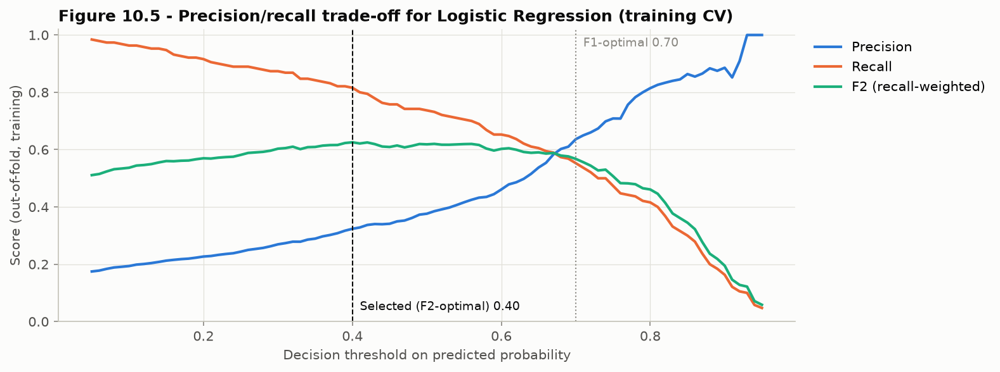

*Figure 4.13 – Precision, recall and F2 against the decision threshold (training-set out-of-fold predictions).*

*Table 4.4 – Final Logistic Regression model on the test set at candidate thresholds*

| Threshold | Accuracy | Precision | Recall | F1 | TN / FP / FN / TP |
|---|---|---|---|---|---|
| 0.50 (default) | 0.762 | 0.361 | 0.638 | 0.462 | 194 / 53 / 17 / 30 |
| 0.70 (F1-optimal) | 0.861 | 0.575 | 0.489 | 0.529 | 230 / 17 / 24 / 23 |
| **0.40 (F2-optimal, selected)** | 0.694 | 0.313 | **0.766** | 0.444 | 168 / 79 / 11 / 36 |

**What the selected threshold means.** At 0.40 the model flags 115 of 294 employees and finds 36 of the 47 leavers. Roughly two of every three flags are false alarms. This trade-off is acceptable only if the follow-up action is low-cost and supportive. An organisation with limited HR capacity could use the 0.70 operating point instead, finding fewer leavers with fewer false alarms.

**Probabilities are not calibrated.** Because class weighting inflates predicted probabilities, the scores should be treated as relative risk rankings, not as calibrated probabilities.

## 4.8 Feature Importance Results

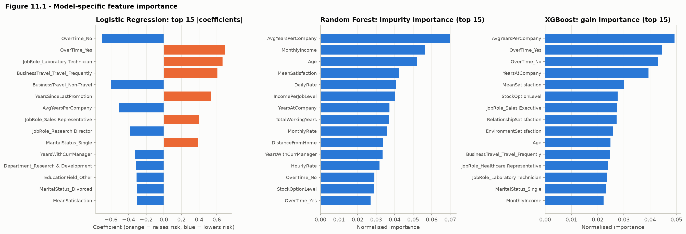

*Figure 4.14 – Logistic Regression coefficients, Random Forest impurity importance and XGBoost gain importance (top 15).*

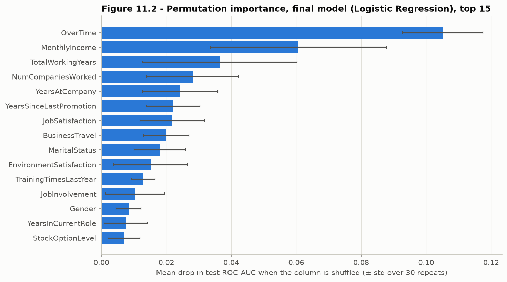

*Figure 4.15 – Permutation importance of the final Logistic Regression model on the test set (drop in ROC-AUC, mean ± std over 30 repeats).*

*Table 4.5 – Permutation-importance ranks of original columns (1 = most important)*

| Column | Logistic Regression | Random Forest | XGBoost | Mean rank |
|---|---|---|---|---|
| OverTime | 1 | 1 | 1 | 1.0 |
| JobSatisfaction | 7 | 2 | 5 | 4.7 |
| BusinessTravel | 8 | 5 | 4 | 5.7 |
| StockOptionLevel | 15 | 3 | 2 | 6.7 |
| MaritalStatus | 9 | 4 | 8 | 7.0 |
| YearsSinceLastPromotion | 6 | 7 | 13 | 8.7 |
| EnvironmentSatisfaction | 10 | 6 | 12 | 9.3 |
| MonthlyIncome | 2 | 28 | 3 | 11.0 |
| NumCompaniesWorked | 4 | 26 | 6 | 12.0 |

**Final model's top permutation importances** (drop in test ROC-AUC):

| Column | Drop |
|---|---|
| OverTime | **0.105** |
| MonthlyIncome | 0.061 |
| TotalWorkingYears | 0.036 |
| NumCompaniesWorked | 0.028 |
| YearsAtCompany | 0.024 |
| YearsSinceLastPromotion | 0.022 |
| JobSatisfaction | 0.022 |

**Largest Logistic Regression coefficients** (standardised inputs):

| Feature | Coefficient |
|---|---|
| OverTime_Yes | +0.70 (contrast with OverTime_No ≈ 1.40, roughly 4× the odds) |
| JobRole_Laboratory Technician | +0.67 |
| BusinessTravel_Travel_Frequently | +0.61 |
| YearsSinceLastPromotion | +0.53 per standard deviation |
| AvgYearsPerCompany | −0.51 |
| JobRole_Sales Representative | +0.40 |
| MaritalStatus_Single | +0.39 |
| JobRole_Research Director | −0.39 |

## 4.9 Interpretation of the Final Model

- **Overtime is the most robust finding.** It ranks first under every model and method, and its odds ratio implies roughly four times higher predicted odds of leaving, other attributes held constant.
- **Income, experience and tenure carry the next-strongest signals.** Lower values are associated with higher risk, consistent with the EDA.
- **Years since last promotion shows a conditional effect.** It looked uninformative on its own, but receives a sizeable positive coefficient once tenure is controlled for. Conditional and marginal associations can differ.
- **Correlated features distort importance.** MonthlyIncome ranks 2nd for Logistic Regression but 28th for Random Forest. The forest can obtain the same information from correlated columns (JobLevel, TotalWorkingYears, IncomePerJobLevel).

**HR reading.** For HR practice, the results point to workload and overtime, early-career pay and progression, frequent travel, and low satisfaction as areas worth group-level review. These are hypotheses for investigation, not established causes.

## 4.10 Comparison with Project Objectives

| Objective | Status | Evidence |
|---|---|---|
| 1 Understand the data | Achieved | Section 3.5, data dictionary (Table 3.1) |
| 2 Identify patterns | Achieved | Section 4.2, Figures 4.1–4.8 |
| 3 Clean and preprocess | Achieved | Table 3.2, Section 3.9 |
| 4 EDA | Achieved | 13 notebook figures with confidence intervals |
| 5 Engineer and select features | Achieved | Table 4.1 (gain measured, small) |
| 6 Train three models | Achieved | Table 4.2 |
| 7 Evaluate and compare | Achieved | Table 4.3, Figures 4.10–4.12, bootstrap CIs |
| 8 Interpret | Achieved | Section 4.8, Table 4.5 |
| 9 Prediction function | Achieved | `predict_attrition()`, saved model |
| 10 Documentation | Achieved | Notebook, README, this report, presentation |

## 4.11 Limitations and Potential Sources of Bias

1. **Synthetic data.** The dataset is fictional, so the findings describe a data generator rather than real employees.
2. **Small sample.** 237 leavers in total and 47 in the test set give wide confidence intervals.
3. **Snapshot timing.** For leavers, tenure-type values may have been recorded at exit, but the timing is undocumented. This could inflate their apparent predictive value.
4. **Missing key variables.** Intention to quit, organisational commitment and labour-market alternatives, which the literature identifies as important [4], are absent.
5. **Undocumented fields.** `DailyRate`, `HourlyRate` and `MonthlyRate` are undefined, and units and currency are not specified.
6. **Sensitive attributes.** The model uses gender and marital status, and no subgroup or fairness analysis has been carried out.
7. **Uncalibrated probabilities.** The probabilities are not calibrated.
8. **Unstable importance.** Feature importances are unstable under correlation and are computed on a small test set.

---

# Chapter 5: Conclusion

## 5.1 Summary

This project applied the full KDD process to predict employee attrition from the IBM HR Analytics dataset:
- The data (1,470 records, 16.1% attrition) was verified, documented and cleaned without removing any rows.
- It was explored with confidence-interval-annotated attrition rates.
- It was modelled with three leakage-safe, cross-validated pipelines.

## 5.2 Main Findings

- **Model performance.** All three models ranked employees by attrition risk far better than chance: test ROC-AUC 0.80 for Logistic Regression, 0.79 for Random Forest and 0.79 for XGBoost. Their differences are within statistical uncertainty.
- **Final model.** Logistic Regression was selected by a pre-stated rule. At a recall-oriented threshold of 0.40 it identified 77% of test-set leavers (36/47) at a precision of 31%.
- **Overtime** is the strongest and most consistent predictor, followed by income/seniority, experience, tenure and promotion timing, job satisfaction, business travel and marital status.
- **Accuracy is unsuitable** for this problem. The most accurate model (Random Forest at 0.5) found the fewest leavers.
- **Feature engineering** produced a consistent but very small improvement.

## 5.3 Achievement of Objectives

All ten objectives were met (Section 4.10). Objective 8 is met in the predictive sense only: the project identifies the features the models rely on, not the causes of attrition.

## 5.4 Practical Significance

The project shows that a simple, interpretable model can provide a useful risk *ranking* on this dataset. It also shows that design choices such as the metric, the threshold and the handling of imbalance change outcomes more than the choice of algorithm does. In a real organisation such a model could support aggregate workforce planning and prompt supportive conversations. Its use would require validation on real data, probability calibration, a fairness audit, transparency towards employees, and human decision-making [16].

## 5.5 Limitations

The main limitations are the synthetic nature and small size of the data, the snapshot design, the absence of key psychological variables, the use of sensitive attributes without a fairness analysis, and the uncalibrated probabilities (Section 4.11).

## 5.6 Future Improvements (Proposed)

1. Validate on newer, real and representative HR data with time-based train/test splits.
2. Calibrate probabilities (Platt scaling or isotonic regression).
3. Fairness and subgroup-performance analysis, and a model variant that excludes protected attributes.
4. External validation on data from another organisation.
5. Monitoring for data drift and performance decay.
6. Test whether additional data (engagement surveys, manager changes, exit-interview themes) improves performance.
7. Cost-sensitive threshold selection using real intervention and attrition costs.
8. Model-agnostic local explanations (e.g. SHAP [29]) for individual-level transparency.

---

# Chapter 6: References

[1] U. Fayyad, G. Piatetsky-Shapiro, and P. Smyth, "From data mining to knowledge discovery in databases," *AI Magazine*, vol. 17, no. 3, pp. 37–54, 1996, doi: 10.1609/aimag.v17i3.1230.

[2] pavansubhasht, "IBM HR Analytics Employee Attrition & Performance," Kaggle, version 1, 2017. [Online]. Available: https://www.kaggle.com/datasets/pavansubhasht/ibm-hr-analytics-attrition-dataset (accessed Oct. 2026). Licence: Open Database License v1.0 / Database Contents License v1.0.

[3] W. H. Mobley, "Intermediate linkages in the relationship between job satisfaction and employee turnover," *Journal of Applied Psychology*, vol. 62, no. 2, pp. 237–240, 1977, doi: 10.1037/0021-9010.62.2.237.

[4] R. W. Griffeth, P. W. Hom, and S. Gaertner, "A meta-analysis of antecedents and correlates of employee turnover: Update, moderator tests, and research implications for the next millennium," *Journal of Management*, vol. 26, no. 3, pp. 463–488, 2000, doi: 10.1177/014920630002600305.

[5] P. W. Hom, T. W. Lee, J. D. Shaw, and J. P. Hausknecht, "One hundred years of employee turnover theory and research," *Journal of Applied Psychology*, vol. 102, no. 3, pp. 530–545, 2017, doi: 10.1037/apl0000103.

[6] D. R. Cox, "The regression analysis of binary sequences," *Journal of the Royal Statistical Society: Series B (Methodological)*, vol. 20, no. 2, pp. 215–232, 1958, doi: 10.1111/j.2517-6161.1958.tb00292.x.

[7] D. W. Hosmer, S. Lemeshow, and R. X. Sturdivant, *Applied Logistic Regression*, 3rd ed. Hoboken, NJ, USA: Wiley, 2013, doi: 10.1002/9781118548387.

[8] L. Breiman, "Random forests," *Machine Learning*, vol. 45, no. 1, pp. 5–32, 2001, doi: 10.1023/A:1010933404324.

[9] J. H. Friedman, "Greedy function approximation: A gradient boosting machine," *The Annals of Statistics*, vol. 29, no. 5, pp. 1189–1232, 2001, doi: 10.1214/aos/1013203451.

[10] T. Chen and C. Guestrin, "XGBoost: A scalable tree boosting system," in *Proc. 22nd ACM SIGKDD Int. Conf. Knowledge Discovery and Data Mining*, San Francisco, CA, USA, 2016, pp. 785–794, doi: 10.1145/2939672.2939785.

[11] R. Punnoose and P. Ajit, "Prediction of employee turnover in organizations using machine learning algorithms," *International Journal of Advanced Research in Artificial Intelligence*, vol. 5, no. 9, 2016, doi: 10.14569/IJARAI.2016.050904.

[12] Y. Zhao, M. K. Hryniewicki, F. Cheng, B. Fu, and X. Zhu, "Employee turnover prediction with machine learning: A reliable approach," in *Intelligent Systems and Applications (IntelliSys 2018)*, Advances in Intelligent Systems and Computing. Cham, Switzerland: Springer, 2018, pp. 737–758, doi: 10.1007/978-3-030-01057-7_56.

[13] F. Fallucchi, M. Coladangelo, R. Giuliano, and E. W. De Luca, "Predicting employee attrition using machine learning techniques," *Computers*, vol. 9, no. 4, Art. no. 86, 2020, doi: 10.3390/computers9040086.

[14] C. Strobl, A.-L. Boulesteix, A. Zeileis, and T. Hothorn, "Bias in random forest variable importance measures: Illustrations, sources and a solution," *BMC Bioinformatics*, vol. 8, Art. no. 25, 2007, doi: 10.1186/1471-2105-8-25.

[15] A. Altmann, L. Toloşi, O. Sander, and T. Lengauer, "Permutation importance: A corrected feature importance measure," *Bioinformatics*, vol. 26, no. 10, pp. 1340–1347, 2010, doi: 10.1093/bioinformatics/btq134.

[16] P. Tambe, P. Cappelli, and V. Yakubovich, "Artificial intelligence in human resources management: Challenges and a path forward," *California Management Review*, vol. 61, no. 4, pp. 15–42, 2019, doi: 10.1177/0008125619867910.

[17] S. Kaufman, S. Rosset, C. Perlich, and O. Stitelman, "Leakage in data mining: Formulation, detection, and avoidance," *ACM Transactions on Knowledge Discovery from Data*, vol. 6, no. 4, pp. 1–21, 2012, doi: 10.1145/2382577.2382579.

[18] T. Saito and M. Rehmsmeier, "The precision-recall plot is more informative than the ROC plot when evaluating binary classifiers on imbalanced datasets," *PLOS ONE*, vol. 10, no. 3, Art. no. e0118432, 2015, doi: 10.1371/journal.pone.0118432.

[19] T. Fawcett, "An introduction to ROC analysis," *Pattern Recognition Letters*, vol. 27, no. 8, pp. 861–874, 2006, doi: 10.1016/j.patrec.2005.10.010.

[20] F. Pedregosa *et al.*, "Scikit-learn: Machine learning in Python," *Journal of Machine Learning Research*, vol. 12, pp. 2825–2830, 2011.

[21] scikit-learn developers, "scikit-learn User Guide," version 1.9. [Online]. Available: https://scikit-learn.org/stable/user_guide.html

[22] XGBoost developers, "XGBoost Documentation." [Online]. Available: https://xgboost.readthedocs.io/

[23] W. McKinney, "Data structures for statistical computing in Python," in *Proc. 9th Python in Science Conf. (SciPy 2010)*, 2010, pp. 56–61, doi: 10.25080/Majora-92bf1922-00a.

[24] J. D. Hunter, "Matplotlib: A 2D graphics environment," *Computing in Science & Engineering*, vol. 9, no. 3, pp. 90–95, 2007, doi: 10.1109/MCSE.2007.55.

[25] M. L. Waskom, "seaborn: Statistical data visualization," *Journal of Open Source Software*, vol. 6, no. 60, Art. no. 3021, 2021, doi: 10.21105/joss.03021.

[26] C. R. Harris *et al.*, "Array programming with NumPy," *Nature*, vol. 585, no. 7825, pp. 357–362, 2020, doi: 10.1038/s41586-020-2649-2.

[27] E. B. Wilson, "Probable inference, the law of succession, and statistical inference," *Journal of the American Statistical Association*, vol. 22, no. 158, pp. 209–212, 1927, doi: 10.1080/01621459.1927.10502953.

[28] B. Efron and R. J. Tibshirani, *An Introduction to the Bootstrap*. New York, NY, USA: Chapman & Hall/CRC, 1994, doi: 10.1201/9780429246593.

[29] S. M. Lundberg and S.-I. Lee, "A unified approach to interpreting model predictions," in *Advances in Neural Information Processing Systems 30 (NIPS 2017)*, 2017. [Online]. Available: https://proceedings.neurips.cc/paper/2017/hash/8a20a8621978632d76c43dfd28b67767-Abstract.html

---

### Note on transferring this report to Microsoft Word

The report is plain Markdown with relative image links and LaTeX equations. One way to convert it, keeping the figures, tables and equations (as editable Word equations), is to run the following from the repository root:

```bash
pandoc Project_Report.md -o Project_Report.docx --resource-path=.
```

Alternatively, open the Markdown in any editor and copy the sections into Word, inserting the PNG files from `visualizations/` where indicated.
